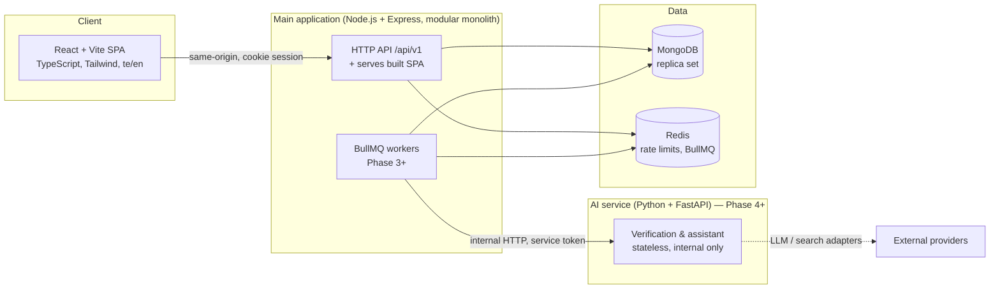
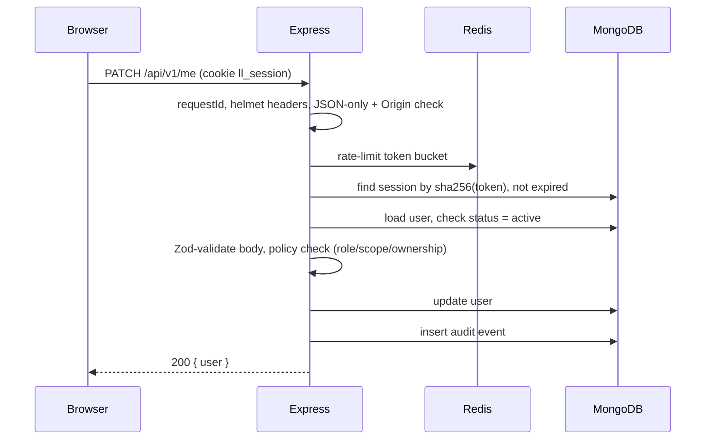
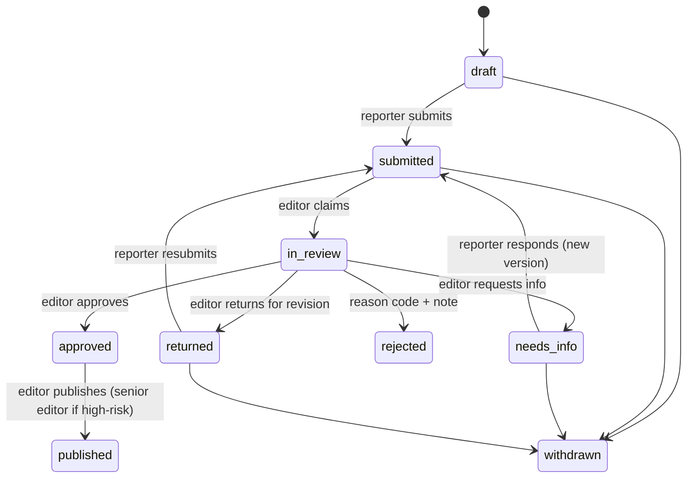

# LocalLens AI — Architecture

Status: **Finalized for the initial release** · Last updated: 2026-10-10

## 1. System overview



**Phase 1 runs:** Web, API, MongoDB, Redis. The app sends no email or SMS. Workers arrive when there is background work to do (Phase 3); the
AI service arrives in Phase 4. Each piece is added when a feature needs it, not before.

## 2. Key decisions and trade-offs

### D1. Modular monolith + separate AI service
- **Why:** one small team; submissions, articles and editorial events must stay consistent; the safety guarantees
  ("never auto-publish", "never lose a submission") are much easier inside one codebase. The AI work has different
  needs (Python ecosystem, slow and failure-prone calls, different scaling), so it is the one thing worth separating.
- **Trade-off:** one deployable for the whole main app; a bad deploy affects everything. Acceptable at pilot scale.
- **Rule that keeps the AI service safe:** it is **stateless and has no database credentials**. It receives inputs and
  returns structured results; only the main application writes to MongoDB. A compromised or misbehaving AI service
  therefore cannot publish anything.

### D2. Express + TypeScript, organised by module
Modules: `identity`, `audit`, `geo`, `catalog`, `publishing`, `newsroom`, `engagement`, `moderation`.
Each module owns its collections and exposes a service; routes never touch another module's models directly.
- **Trade-off:** Express gives little structure itself (unlike NestJS), so the structure is a convention we enforce in
  code review. Express 5 is used because it forwards errors from async handlers to the error handler, removing a
  classic source of hanging requests.

### D3. MongoDB
- **Why it fits:** articles, revisions and submissions are document-shaped; location hierarchy and future AI evidence
  have variable structure; adding a field for a new district or language needs no migration.
- **Costs we accept, and how we handle them:**

| Cost | Mitigation |
|---|---|
| No foreign keys | Services validate references; integrity check script in CI for seeded data |
| Multi-document transactions need a replica set and are slower | Run a single-node replica set even in dev; design writes so most are single-document; use transactions only for publish/correct (Phase 3) |
| Text search has no Telugu analyzer | Text index with `default_language: "none"` + normalised search keys + alias arrays; revisit (Atlas Search or a search service) if pilot search quality is poor |
| No DB-level append-only guarantee by default | App-level append-only for `audit_events`; in production the app user gets a custom role with only `insert` + `find` on that collection |
| Schema drift | Mongoose schemas + strict mode + Zod validation at the API edge |

### D4. Shared contracts package
`packages/contracts` holds Zod schemas for request and response bodies. The API validates with them; the web app
infers TypeScript types from them. A changed contract breaks the compile on both sides instead of in production.

### D5. Same-origin serving
In production the Express server also serves the built SPA, so the browser talks to one origin.
- **Benefits:** no CORS, cookies are first-party, one container to deploy (cheaper).
- **Trade-off:** a plain SPA has no server-rendered pages, so links shared on WhatsApp would show no preview. Mitigation
  (Phase 2): Express injects Open Graph meta tags into `index.html` for `/articles/:slug` routes. This is cheap and fixes
  most of what SSR would have given us.

### D6. Sessions, not JWTs
Opaque random session ID in an `httpOnly`, `SameSite=Lax`, `Secure` cookie; only its SHA-256 hash is stored in MongoDB
(with a TTL index).
- **Why:** sessions can be revoked instantly (suspending an abusive account, "sign out everywhere").
  A JWT stays valid until it expires unless you build a revocation list, which is a session store anyway.
- **Trade-off:** one indexed lookup per authenticated request. Negligible.

### D7. Background jobs: a MongoDB-backed queue (changed from the planned Redis + BullMQ)
- Redis still backs the rate limiter in deployed environments (limits shared by all API instances).
- **Jobs use a `jobs` collection in MongoDB instead of BullMQ** (decided in Phase 4). Reasons: the work that creates a job
  (a submission, an article) is already a MongoDB write, so there is no "saved but not queued" gap to bridge with an
  outbox relay; one less moving part to run and back up; pilot volume (hundreds of jobs a day) is far below what a
  polled collection handles. Trade-off: polling every 2 s instead of push, and no built-in dashboard (the admin
  Operations page covers what we need). Revisit if jobs exceed ~50/s or need sub-second latency.
- Semantics: at-least-once delivery with a lease (`lockedUntil`), exponential backoff with full jitter, permanent vs
  transient errors, a per-type circuit breaker (5 transient failures → paused 2 minutes), and unique `dedupeKey`s so
  enqueueing twice is a no-op. Handlers are idempotent.
- Sweepers (every minute) repair gaps: re-queue verifications that never started, re-raise recent publish/correction
  events, and queue the daily deadline-reminder run (once per India date).

### D8. Degraded modes (no single dependency takes down reading)
| Dependency down | Behaviour |
|---|---|
| Redis | Rate limiter fails open for reads, fails **closed** for login, registration and the AI assistant |
| AI service / model | Submissions still reach editors (`aiStatus: unavailable` + a note in the timeline after retries); the assistant answers "unavailable"; nothing is published or blocked by AI |
| Job worker | Reading, writing and publishing work; alerts and AI analyses are delayed until it is back (jobs wait in MongoDB) |
| MongoDB | Service unavailable; `/readyz` fails so the load balancer stops sending traffic |

## 3. Request flow (authenticated request)



## 4. Article lifecycle

### 4.1 Submission (reporter side)

`aiStatus` (`not_requested | pending | completed | failed | unavailable`) is a **separate field**. No editorial
transition checks it, which is what makes the product work without AI.

### 4.2 Article (public side)

```mermaid
stateDiagram-v2
    [*] --> published : editor publishes / authorised publisher direct-publishes
    published --> published : update / correction / clarification (new immutable revision + public notice)
    published --> unpublished : editor withdraws (legal or error; audit reason required)
    unpublished --> published : editor republishes
    published --> retracted : senior editor retracts (stays at URL with notice)
```

- **Unpublished and retracted articles are never deleted.** Retracted articles keep their URL and show the notice.
- Every transition is validated by one function, `transition(entity, from, to, actor)`, and writes an
  `editorial_events` record in the same transaction as the state change.

## 5. Repository layout

```
locallens/
├─ apps/
│  ├─ api/            Express + TypeScript (modular monolith)
│  └─ web/            React + Vite + TypeScript + Tailwind
├─ packages/
│  └─ contracts/      Zod schemas shared by api and web
├─ services/
│  └─ ai/             Python + FastAPI (Phase 4)
├─ docs/
├─ docker-compose.yml infra for local dev (+ optional "app" profile)
├─ Dockerfile         single production image: API + built SPA
└─ .github/workflows/ CI
```

## 6. Observability (initial release)
- Structured JSON logs (pino) with `requestId` on every line, returned to the client as `X-Request-Id` and in error bodies.
- `/healthz` = process is alive; `/readyz` = MongoDB reachable. Kept separate so a database outage does not cause restart loops.
- Audit events for security-relevant actions (see `05-security-model.md`).
- Metrics and tracing (OpenTelemetry) are added with the workers in Phase 3, when there is an asynchronous path to trace.

## 7. Environments

| | Local dev | Pilot production |
|---|---|---|
| API + web | `npm run dev` (Vite dev server proxies `/api`) | One container from the root `Dockerfile` |
| MongoDB | Docker single-node replica set (host port 27018) | MongoDB Atlas free/shared tier (replica set included) |
| Redis | Docker (host port 6380) | Managed Redis free tier, or Redis on the same VM |

## 8. Cost plan (pilot)
- Option A: one small VM (≈2 vCPU / 4 GB) running the app container + Redis, with Atlas free-tier MongoDB.
- Option B: a container platform's free/hobby tier + Atlas free tier + managed Redis free tier.
- Both keep the pilot in the range of **$0–25/month** at current published prices (verify before choosing; free tiers change).
- The largest future cost is **LLM usage** (Phase 4+). Controls: per-user rate limits on the assistant, verification
  only on submitted stories (not on every article read), and cheap models for classification.

## 9. Modules added in Phases 3–8
| Module (apps/api/src/modules) | What it does |
|---|---|
| `newsroom` | Reporter submissions, the editorial state machine, risk screen, duplicates, publisher policy, **track record** and **appeals** |
| `jobs` | The MongoDB job queue, worker, breakers and sweepers (D7) |
| `verification` | Queues AI analysis of a submission and stores the report; can only *add* scrutiny (raise risk), never approve |
| `assistant` | Reader questions answered from retrieved published articles via the AI service; 24 h answer cache |
| `notifications` | In-app alerts (new article in a followed place/topic, corrections/retractions, deadline reminders) |
| `admin/ops` | Operations dashboard, failed-job retry, audit log viewer |
| `services/ai` (Python) | Stateless FastAPI: SSRF-safe source fetching, claim extraction/assessment with verbatim-quote guardrails, grounded answers. Ollama locally, Claude (`claude-opus-5-5`) in production |

The AI service holds no database credentials and is reachable only from the API (shared `X-Service-Token`).

